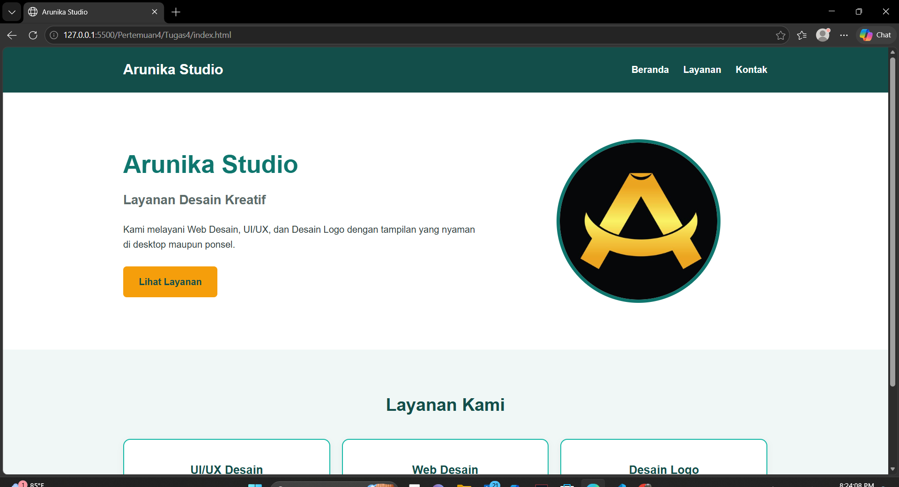
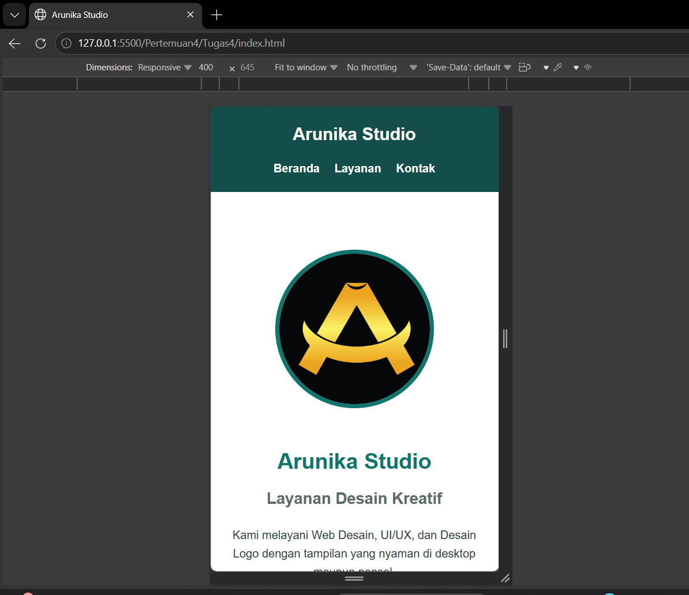

# Arunika Studio - Landing Page Responsif

## Identitas

- **Nama**: Ridho Sachlan
- **NIM**: 4525210066
- **Mata Kuliah**: Praktikum Desain Web

## Studi Kasus

Arunika Studio membutuhkan *landing page* sederhana yang tetap nyaman pada desktop dan ponsel. Konten terdiri dari *header*, *hero*, tiga layanan, dan *footer*. Masalah utama adalah kode CSS tidak boleh tersebar serta tiga *card* harus berubah menjadi satu kolom pada layar kecil.

## Struktur Folder

```
Tugas4/
├── img/
│   ├── dekstop.png   
│   ├── logo.png       
│   └── mobile.png     
├── index.html
├── style.css
└── README.md
```

## Cara Menjalankan

1. Unduh atau clone repository 
2. Buka `index.html` langsung di browser, atau gunakan ekstensi **Live Server** di VS Code.

## Tampilan Responsif

**Desktop**: hero berdampingan (teks di kiri, gambar di kanan) dan tiga card tampil dalam tiga kolom.



**Mobile (di bawah 768px)**: navigasi dirapikan, hero menjadi satu kolom, dan tiga card tersusun dalam satu kolom.



## Teknologi

- HTML5
- CSS3 (Flexbox, CSS Grid, CSS Variables, Media Query)
